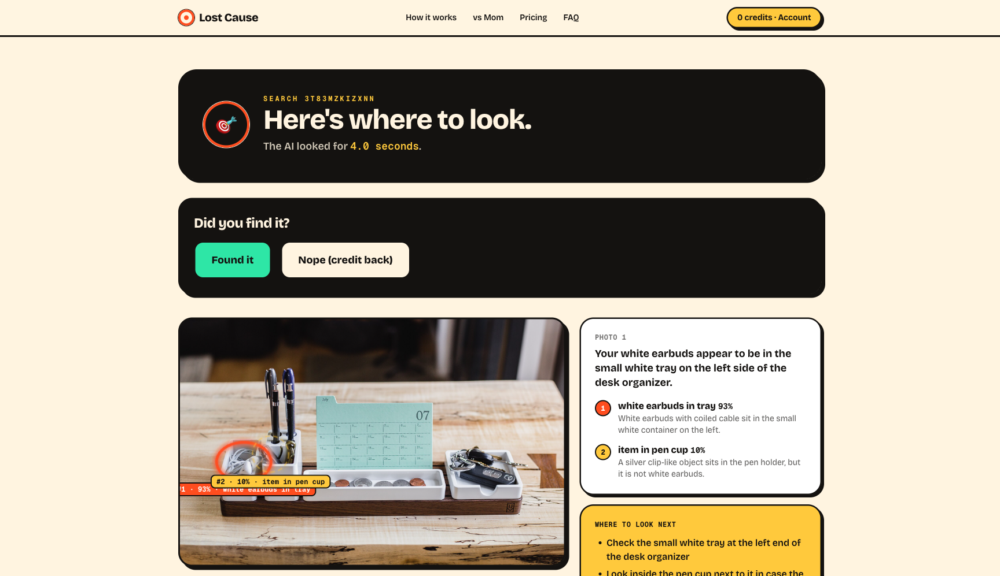

# Lost Cause

**We specialise in lost causes.** Send photos of where you lost something, spend a credit, and an AI marks where to look. R10 a find.

**Live:** https://lost-cause--lost-cause-2026.europe-west4.hosted.app

A small, real website built stage by stage with AI coding agents, and filmed while it was built: a landing page, Google sign-in, credit packs paid through PayFast, photo upload, and an AI vision search that marks the likely spots on your photo. It runs on Firebase and takes real payments in rand. If this can be built, so can your idea.


## How it works

1. **Sign in with Google.**
2. **Buy credits.** R10 a find: 3 finds for R30, 10 for R100, 25 for R250, paid through PayFast.
3. **Send the scene.** One to five photos of where it was last seen, and a sentence about what's missing. Location data is removed before the photos are stored.
4. **Get where to look.** For each photo, the server makes 5 images: the whole photo, plus four overlapping zoomed-in quarters, each shrunk to fit 1024 px. They go to Claude (`claude-sonnet-5-5`) in one request, which answers in strict JSON: each spot the item might be, with a box, a confidence and a reason, plus where to look next. The app maps the boxes back onto your photo and marks them, most likely first. A one-photo search usually takes 4–9 seconds.
5. **Found it, or Nope.** "Nope" gives the credit back, once per search.



**Why it's built this way:** every decision, with the reason given at the time and what it cost, is in [docs/decisions.md](docs/decisions.md).

## What it runs on

| Part | What | Where |
|---|---|---|
| The site | Next.js 16 (App Router, TypeScript, Tailwind) on Firebase App Hosting | europe-west4 (Netherlands) |
| Data | Firestore: users, credits, orders, searches, the AI call ledger, daily AI spend, the PayFast ITN log | africa-south1 (Johannesburg) |
| Photos | Cloud Storage, private. Browsers can't read the bucket; the server streams each photo only to its owner | africa-south1 |
| Sign-in | Firebase Auth with Google, then an httpOnly session cookie | |
| Cleanup | A scheduled Cloud Function deletes photos after 7 days | europe-west4 |
| AI | Anthropic's Claude, one vision request per photo | |
| Payments | PayFast, live | |

Every credit change happens in a Firestore transaction: a credit is spent once, "Nope" refunds once, a failed search refunds once, and a payment credits once.

## Payments (PayFast)

- **Checkout:** a pack button creates an order with the price from the server, then posts PayFast's payment form, signed on the server (MD5 of the fields in PayFast's order plus a passphrase that is never sent).
- **Confirmation:** only PayFast's ITN (Instant Transaction Notification) adds credits. The handler checks the signature, that the request comes from a published PayFast address, the amount, and asks PayFast's server to confirm, then credits the order exactly once. The browser's return from PayFast proves nothing, so it only waits for the ITN.
- **Sandbox and live** differ only by configuration: `PAYFAST_MODE` and the merchant ID, key and passphrase.
- Behind App Hosting there are three proxies in `X-Forwarded-For` (`ITN_PROXY_HOPS=3`), measured from a real sandbox ITN.
- In local development PayFast can't reach `localhost`, so with the sandbox, and only in development, the return URL confirms the order instead, labelled **DEV ONLY**.

## Safety limits

- EXIF and GPS are removed from every photo before it's stored. HEIC is declined, because it can't be decoded here to strip its location.
- Photos are deleted after 7 days, every night at 03:00 SAST.
- Photos that are mainly of a person are declined (the AI decides in the same request) and deleted.
- 10 searches per user per hour.
- A global daily AI budget (default $5). Each call reserves its cost before it's made; once the day's budget is used, searches pause and take no credit.
- A failed search, or one stuck for 3 minutes, gives the credit back.

## What a search costs

Each photo is one Claude request with 5 images: about 5,700–6,500 input and 290–790 output tokens, so **about $0.014–0.019 per photo** (roughly R0.25–0.35) at Sonnet 5.5's $2 / $10 per million tokens, measured on real searches. Every call is logged with its tokens and cost.

## Run it locally

You need Node.js 22, Java 21 (for the Firebase emulators) and the Firebase CLI.

```bash
cd app
npm install
(cd ../functions && npm install)
cp .env.example .env.local   # your Anthropic key and PayFast sandbox values
npm run emulators            # terminal 1: Auth, Firestore, Storage, Functions on your machine
npm run dev                  # terminal 2: http://localhost:3000
npm run test:emulators       # proves the credit rules under concurrency (no AI or PayFast calls)
```

Locally everything runs on the Firebase emulators under the project ID `demo-lost-cause`. `demo-` projects can't reach the real Firebase. "Continue with Google" opens the emulator's fake Google window.

## Environment variables

Listed in [`app/.env.example`](app/.env.example). In production they're set in [`app/apphosting.yaml`](app/apphosting.yaml); the four secrets come from Cloud Secret Manager (`firebase apphosting:secrets:set NAME --data-file FILE`).

| Variable | What it's for |
|---|---|
| `LOST_CAUSE_ANTHROPIC_API_KEY` | Anthropic API key (secret). Passed to the SDK explicitly. |
| `LOST_CAUSE_MODEL` | The Claude model (default `claude-sonnet-5-5`). |
| `PAYFAST_MERCHANT_ID`, `PAYFAST_MERCHANT_KEY`, `PAYFAST_PASSPHRASE` | From the PayFast dashboard (secrets). |
| `PAYFAST_MODE` | `sandbox` or `live`. |
| `APP_URL` | The public base URL. Return, cancel and notify URLs and redirects are built from it. |
| `LOST_CAUSE_DAILY_SPEND_CAP_USD` | Daily AI budget (default `5`). |
| `LOST_CAUSE_SEARCHES_PER_HOUR` | Per-user limit (default `10`). |
| `ITN_PROXY_HOPS` | Proxies in front of the app, for the ITN source check (`3` on App Hosting). |
| `FIREBASE_WEBAPP_CONFIG` | The public Firebase web config for the sign-in page. |

## Two versions

Version 1 was bright and jokey (a hand-drawn ring, sticker shadows, a "vs Mom" table). Version 2 is a quiet investigator's desk: a dark navy page, paper-coloured text, one amber accent, and a thin crosshair ring on a find. The hero and background images were made with ChatGPT. The change was made at the level of the colour tokens, so every page changed at once and no flow or check moved.

## Honest limits

- **Live payments are switched on but untested with real money.** PayFast's live page accepts the signed checkout; the first real purchase is still to come.
- Google's sign-in window says "continue to lost-cause-2026.firebaseapp.com" (Firebase's default sign-in domain), not the site's own address.
- **The AI can be wrong.** It works best when the item is visible somewhere in the photo. It can't see under cushions, and says so with low confidence.
- The "photo of a person" check hasn't been tested against a real photo of a person yet.
- Labels can overlap when two marks are close together.
- There's no self-serve account deletion yet; it's by email (see the privacy page).
- No custom domain yet.

## Built with

Next.js, Tailwind CSS, Firebase (App Hosting, Auth, Firestore, Cloud Storage, Cloud Functions), sharp, zod, the Anthropic TypeScript SDK and PayFast. Test photos in `test-photos/` are synthetic drawings or free-licence photos; sources and licences are in [`test-photos/SOURCES.md`](test-photos/SOURCES.md).

## Licence

MIT. See [LICENSE](LICENSE).
