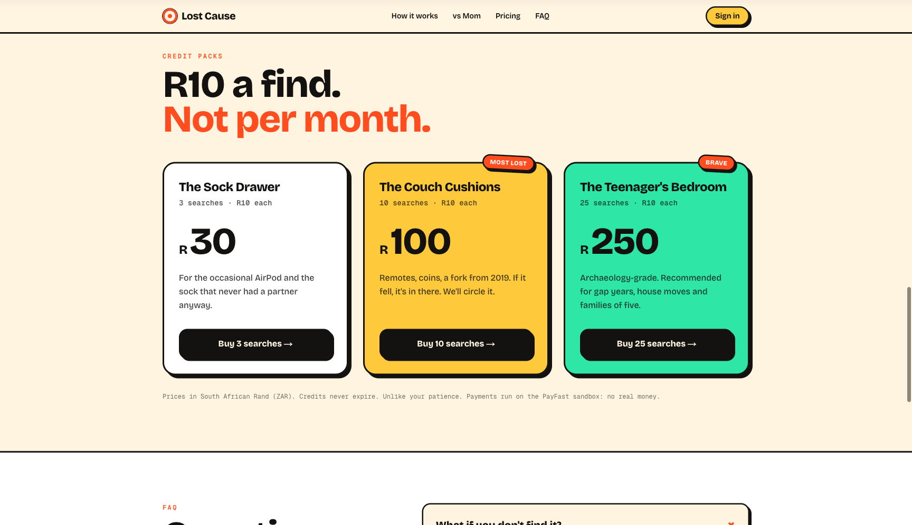

# Lost Cause

**We specialise in lost causes.** Take a photo of where you lost something, spend a credit, and an AI circles where to look.

It's a joke-but-real website built to show how far one person with AI coding agents can take a silly idea: a landing page, sign-in, credit packs paid through PayFast, photo upload, and a real AI vision search that draws circles on your photo. If this can be built, so can your idea.


## How it works

1. **Snap the scene.** Upload 1–5 photos of the place you lost it, plus a sentence about what you lost.
2. **Spend a credit.** R10 a find. Credits come in packs: 3 for R30, 10 for R100, 25 for R250.
3. **Follow the circles.** For each photo, the server makes 5 images: the whole photo, plus four overlapping zoomed-in quarters. They're shrunk to fit 1024 px and go to Claude (`claude-sonnet-5-5`) in one request. Claude answers in strict JSON: each spot it thinks the item might be, with a box, a confidence and a reason, plus "where to look next". The app maps the boxes back onto your original photo and draws glowing circles, most likely first.
4. **Found it, or Nope.** "Nope" gives your credit back, once per search.

The search page shows a scan line and a running timer while the AI looks. A one-photo search usually takes 4–9 seconds.



## Run it locally

You need Node.js 22 or newer.

```bash
cd app
npm install
cp .env.example .env.local   # then fill in your own values, see below
npm run dev                  # http://localhost:3000
```

Sign-in is passwordless: you enter an email and get a 6-digit code. In development there's no email provider; the code appears in a clearly labelled **DEV mailbox** at `/dev/mailbox`.

Data lives on your machine: SQLite in `app/data/` (users, sessions, credits, orders, searches, AI call log) and uploaded photos in `app/uploads/`. Both are gitignored.

## Environment variables

All of them are listed in [`app/.env.example`](app/.env.example). Copy it to `app/.env.local` and never commit that file.

| Variable | What it's for |
|---|---|
| `LOST_CAUSE_ANTHROPIC_API_KEY` | Your Anthropic API key (console.anthropic.com → API keys). The app passes it to the SDK explicitly. |
| `LOST_CAUSE_MODEL` | Optional. The Claude model that looks at the photos (default `claude-sonnet-5-5`). |
| `LOST_CAUSE_AI_CALL_LIMIT` | Optional, development only. Stops after this many vision calls (default 30). |
| `PAYFAST_MERCHANT_ID`, `PAYFAST_MERCHANT_KEY`, `PAYFAST_PASSPHRASE` | From your PayFast dashboard after you log in (sandbox or live). The passphrase is one you set there. |
| `PAYFAST_PROCESS_URL` | `https://sandbox.payfast.co.za/eng/process` for testing, `https://www.payfast.co.za/eng/process` when live. |
| `PAYFAST_MODE` | `sandbox` or `live`. |
| `SESSION_SECRET` | Signs the login cookie. Make one with `openssl rand -hex 32`. |
| `APP_URL` | The public address PayFast sends buyers back to (default `http://localhost:3000`). |

## PayFast notes

[PayFast](https://payfast.io) is a South African payment gateway: the business signs up, gets a merchant ID and key, and sends buyers to PayFast's page to pay. PayFast then tells the business the payment happened.

- **Checkout:** a pack button creates an order in SQLite, then posts PayFast's payment form to `PAYFAST_PROCESS_URL`. The form is signed on the server (an MD5 of the fields in PayFast's documented order, plus your passphrase, which is never sent). The price always comes from the server, never the browser.
- **Confirmation (ITN):** PayFast calls `/api/payfast/notify` from the internet. The handler runs PayFast's four checks before crediting anything: the signature, the source IP (PayFast's published hosts), the amount, and a server-to-server "VALID" confirmation. It credits each order exactly once.
- **Local development:** PayFast can't reach `localhost`, so the ITN never arrives. In development + sandbox only, the return URL confirms the order instead, through a path clearly labelled **DEV ONLY** on the account page. In production, only the ITN credits accounts.
- **Testing:** use the sandbox at sandbox.payfast.co.za and the sandbox wallet's "Complete Payment". No real money moves.

## What a search costs

Each photo is one Claude request with 5 images: about 5,700–6,500 input tokens and 290–790 output tokens. At Claude Sonnet 5.5's $2 / $10 per million tokens, that's **about $0.014–0.019 per photo** (roughly R0.25–0.35), measured on real searches. A one-photo search costs well under R1 in AI, against R10 charged. Every call is logged in the `ai_calls` table with its tokens and cost.

## Honest limits

- **It's a demo, not a product.** It runs locally with SQLite and a local `uploads/` folder. There's no deployment, no email provider, and no PayFast live mode tested.
- **The AI can be wrong.** It works best when the item is visible somewhere in the photo. It can't see under cushions, and it says so with low confidence.
- **HEIC photos** (iPhone default) are accepted but skipped by the AI step, because the image library used can't decode them yet.
- **Not yet built:** removing location data and deleting photos after 7 days, refusing photos of people, and rate limits beyond the sign-in code limits.
- A circle at the very edge of a photo gets clipped, and labels can overlap when two circles are close together.
- Prices are in ZAR and the app was tested against the PayFast sandbox only.

## Built with

Next.js (App Router, TypeScript), Tailwind CSS, SQLite (better-sqlite3), sharp, zod, the Anthropic TypeScript SDK and PayFast. Test photos in `test-photos/` are synthetic drawings or free-licence photos; sources and licences are in [`test-photos/SOURCES.md`](test-photos/SOURCES.md).

## Licence

[MIT](LICENSE) © 2026 Mark Grenville
